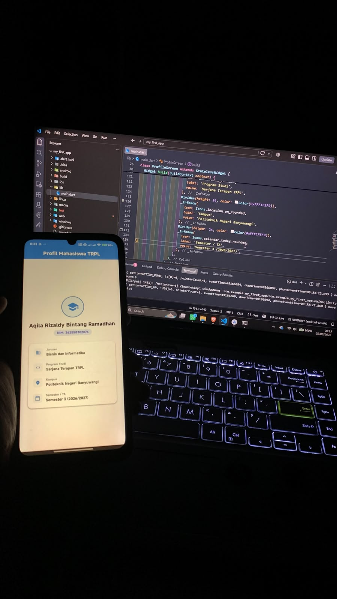

# Laporan Praktikum Modul 01: Mobile Ecosystem, Flutter Setup & Profile App

- **Nama**: [Aqila Rizaldy Bintang Ramadhan]
- **NIM**: [362558302074]
- **Kelas / Prodi**: 2A / Sarjana Terapan TRPL
- **Mata Kuliah**: Pemrograman Perangkat Bergerak (Semester 3)

---

## 1. Ringkasan Aktivitas
[Mengetahui JIT dan AOT pada produktivitas developer seperti apa itu hot reload dan hot restrat, selain itu pada modul 1 menjelaskan flutter menggunakan paradigma deklaratif ui, berbeda dengan android xml. pada modul 1 juga menjelaskan struktur ui proyek flutter tersusun dalam pohon widget tree. Selain itu juga pada modul juga dijelaskan step by step untuk menyusun sebuah aplikasi mobile menggunakan perangkat emulator dan perangkat fisik.]

## 2. Bukti Tangkapan Layar (Running App)
[Sertakan minimal 2 screenshot bukti aplikasi profil berjalan di emulator atau HP fisik Anda]

## 3. Kendala yang Dihadapi & Solusinya
- **Kendala**: [sedikit terjadi error kanera device fisik saat flutter tidak connect karena kabel kurang pas dan usb debuggingnya ada beberapa yang belum di aktifkan. selain itu untuk android emulator saya tidak mencobanya dikarenakan spesifikasi laptop kurang mempuni saat digunakan]
- **Solusi**: [jadi saya menggunakan devices fisik untuk mengganti android emulatornya. melakukan setting kembali pada usb debugging dan mengganti kabel data yang lebih baik]

## 4. Jawaban Pertanyaan Refleksi
1. **Pilihan Native vs Flutter**: [Flutter lebih efektif untuk pengembangan aplikasi multiplatform karena menggunakan satu basis kode. sementara itu, native lebih sesuai untuk aplikasi yang membutuhkan performa optimal dan akses perangkat yang lebih spesifik.]
2. **Prinsip UI = f(state)**: [Bahwa tampilan antarmuka harus menyesuaikan kondisi (state) aplikasi. setiap perubahan state akan memperbarui tampilan sehingga data dan antarmuka tetap konsisten.]
3. **Pentingnya Conventional Commits**: [Conventional Commits digunakan untuk pesan commit yang terstruktur dan konsisten. penerapannya memudahkan pelacakan perubahan, kolaborasi, serta pengelolaan proyek.]#